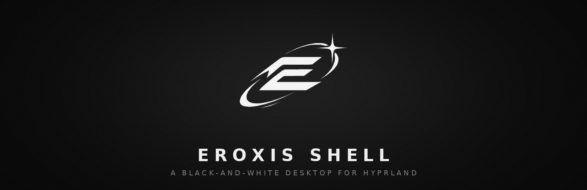
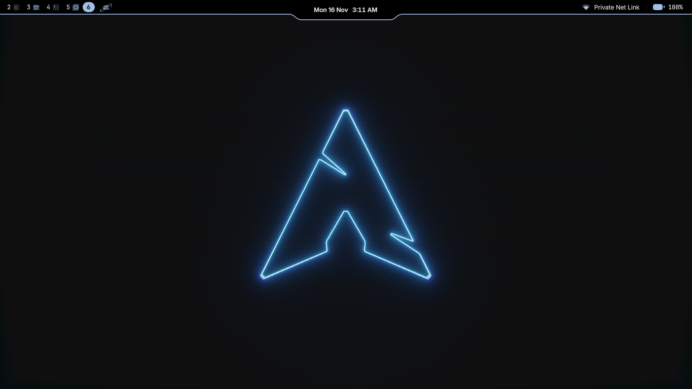
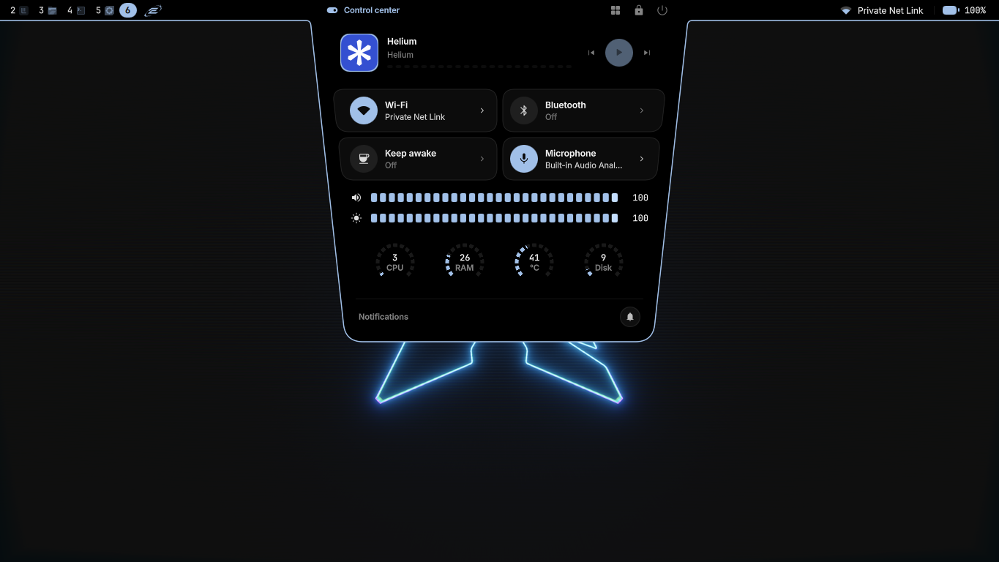
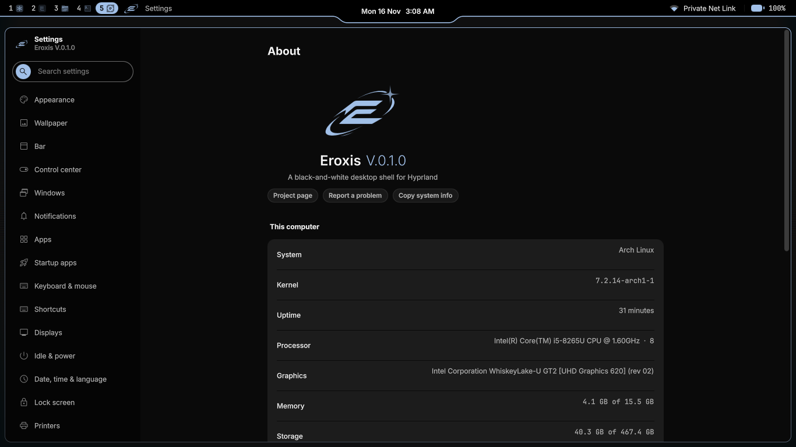

<p align="center"></p>

**Eroxis Shell** is a black-and-white desktop shell for **Hyprland**. A bar with an "island" in the middle that grows
into the launcher, control center, sound, Wi-Fi, Bluetooth, media, notifications, timers and more; a lock screen; a
settings app. Dark by default, no color, nothing generic.

It is made for **Arch Linux and Arch-based systems such as CachyOS** that run Hyprland. It installs on the system you
already have; it is not an operating system.

> **Version 0.1.0**, the first public release. Something wrong or missing? Open an issue, and paste what
> **Settings > About > Copy system info** gives you.

<div align="center">

### Preview

<table>
  <tr>
    <td align="center">
      <a href="docs/Screenshots/bar.png">
        
      </a>
      <br><b>Desktop Bar</b>
    </td>
    <td align="center">
      <a href="docs/Screenshots/control.png">
        
      </a>
      <br><b>Control Center</b>
    </td>
    <td align="center">
      <a href="docs/Screenshots/settings.png">
        
      </a>
      <br><b>Settings</b>
    </td>
  </tr>
</table>

<sub>Click an image to view it in full resolution.</sub>

</div>

## What you get

- The bar and island, the control center (you choose which parts show and how wide it is), notifications, and the
  lock screen
- A launcher that finds apps, files, clipboard history and emoji, and does calculations and unit conversions
- Panels for sound, Wi-Fi, Bluetooth, hotspot, night light, keep-awake, timers, screenshots and screen recording
- A settings app, with an editor for every keyboard shortcut
- Four themes (one light, three dark), one accent that is a shade of grey, and wallpapers that fit
- Matching colors in the terminal, GTK and Qt apps (Dolphin included), btop, fastfetch and VS Code
- Light on memory: parts of the shell load the first time you use them and let go a minute after, and Settings, Help
  and the Calendar only run while they are open. **Settings > About** shows what Eroxis uses right now.

## Before you start

- An Arch-based system with `sudo` (Arch, CachyOS, EndeavourOS, ...), up to date: `sudo pacman -Syu`
- **Hyprland 0.55 or newer.** The configuration is a Lua file, which Hyprland reads from 0.55 on. The installer checks.
- A way to start Hyprland: its entry in your login screen, or `Hyprland` from a TTY

You can put Eroxis Shell on in two ways. **Pick one.**

---

## Method 1: install it permanently

Eroxis Shell becomes your Hyprland desktop. Your current Hyprland configuration is saved first.

**1. Get it**

```sh
git clone https://github.com/exotic-erox/eroxis-shell.git
cd eroxis-shell
```

**2. Install it**

```sh
./install.sh
```

It asks for your password (sudo), installs what is missing from the repositories (and from the AUR with `paru` or
`yay`, if you have one and something is only there), and copies the files into place. It never touches packages you
already have, and it keeps `quickshell-git` or `hyprland-git` if that is what you use.

If you already have a `~/.config/hypr`, it is copied to `~/.config/eroxis-backup/<date>/hypr` before anything else.

**3. Start it**

Log out, choose **Hyprland** at your login screen (or run `Hyprland` from a TTY). The shell starts by itself and
shows a welcome screen the first time.

**To update:** `cd eroxis-shell && git pull && ./install.sh`

**To remove it:** `./install.sh --uninstall` puts your old Hyprland configuration back. The packages stay.

---

## Method 2: try it next to your current setup, with tapes

[tapes](https://github.com/futurekismo-oss/tapes-v2) switches whole desktop configurations with one command and
switches back with another. Your current setup stays where it is; Eroxis Shell lives in its own "tape". This is the way
to go if you like your current rice, or want to see Eroxis Shell before you commit.

**1. Install tapes**

Follow its README, or with Rust: `cargo install tapes-v2` (on Arch: `sudo pacman -S rust` first, and make sure
`~/.cargo/bin` is in your `PATH`). If the command is called `tapes-v2`, add `alias tapes="tapes-v2"` to your shell
config. Check it works: `tapes --version`

**2. Get Eroxis Shell, and keep the folder**

```sh
git clone https://github.com/exotic-erox/eroxis-shell.git
cd eroxis-shell
```

The tape links into this folder, so do not delete or move it.

**3. Make the tape**

```sh
./install.sh --tape --from NAME
```

Replace `NAME` with the Quickshell config of the shell you use now: if it starts with `qs -c myshell`, that is
`--from myshell`. Eroxis stops that shell when you switch in, and starts it again when you switch out. If your
current bar is not a Quickshell shell, leave `--from` out and say what starts it with
`--back-to 'command'` (for example `--back-to waybar`).

This installs the packages and a few helper files, and makes `~/.tapes/eroxis-shell`. **Nothing in `~/.config` is
changed.**

**4. Look before you switch**

```sh
tapes show eroxis-shell
tapes insert eroxis-shell --dry-run
```

`show` lists what the tape replaces (`hypr`, `quickshell`, `fastfetch` and a few theme folders) and the commands it runs.
The dry run prints what would happen and changes nothing.

**5. Switch**

Run this from a terminal inside your Hyprland session:

```sh
tapes insert eroxis-shell
```

Within a few seconds your old shell goes away and Eroxis Shell appears.

**6. Switch back**

```sh
tapes eject
```

Your old setup returns, as it was.

**If something goes wrong:** your files are safe, and `tapes eject` undoes the switch. If it does not, tapes keeps your
original `~/.config` as `~/.config.tapes`, and from a TTY you can put it back:

```sh
mv ~/.config ~/.config.tape-junk
mv ~/.config.tapes ~/.config
```

**To update:** `cd eroxis-shell && git pull`. An inserted tape follows along (the shell reloads by itself; run
`hyprctl reload` for the Hyprland part). If a release changes the installer, run `./install.sh --tape --no-packages
--from NAME` again.

**To remove it:** `tapes eject`, delete `~/.tapes/eroxis-shell`, then `./install.sh --uninstall` for the helper files.

One thing a tape cannot swap: the GTK theme, cursor and font settings Eroxis sets live in dconf, not in `~/.config`. If
your old setup looks off after an eject: `gsettings reset-recursively org.gnome.desktop.interface`

---

## Using it

| Keys | What |
|------|------|
| tap `SUPER` | control center; start typing to search apps |
| `SUPER` + `Return` / `E` / `B` | terminal / files / browser |
| `SUPER` + `A` | all apps |
| `SUPER` + `R` | run a command |
| `SUPER` + `V` | clipboard history |
| `SUPER` + `W` | wallpapers |
| `SUPER` + `I` | settings |
| `SUPER` + `F1` | every shortcut |
| `SUPER` + `SHIFT` + `S` | screenshot a region |
| hold `SUPER` and scroll | switch workspace (as many as you like) |
| `SUPER` + `L` | lock |
| `SUPER` + `Escape` | power menu |

Every shortcut, and how to change them, is in [docs/KEYBINDS.md](docs/KEYBINDS.md). In the app: **Settings >
Shortcuts**.

**Settings** (`SUPER` + `I`) is where light or dark, the accent, the bar, the control center, the default terminal, browser and
files, and the shortcuts are. Your own Hyprland additions go in **`~/.config/hypr/user.lua`**, which updates
never overwrite (with tapes: `~/.tapes/eroxis-shell/hypr/user.lua`).

`./install.sh --fetch-hook` makes a new terminal print a system summary: the full one with the logo as a picture in a big
terminal (kitty, and foot or others with `chafa`), a few lines in a small one. fish is set up for you; for bash or zsh the
installer prints the one line to add.

## If something does not work

| What you see | Try |
|--------------|-----|
| A black screen or only a wallpaper | Switch to a TTY (`Ctrl` + `Alt` + `F3`), then `journalctl --user -u eroxis-shell -b --no-pager \| tail -40`. With tapes: `tapes eject`. |
| Hyprland shows a configuration error | Your Hyprland is probably older than 0.55: `Hyprland --version`, then `sudo pacman -Syu`. |
| Two bars or shells at once | `pkill -x qs`, then `systemctl --user restart eroxis-shell` |
| No wallpaper | `systemctl --user status eroxis-wallpaper`; `awww` must be installed. |
| The shortcuts list in Settings is empty | It fills in when Hyprland loads the configuration: press **Load it now**, or `hyprctl reload`. |
| You want the defaults back | Delete `~/.config/quickshell/settings.json` (with tapes: in `~/.tapes/eroxis-shell/quickshell/`). |
| Anything else | Run `qs -c eroxis` in a terminal: it prints what is wrong. |

## What's in the repository

```
install.sh     the installer (permanent, or --tape)
shell/         the Quickshell shell (installed to ~/.config/quickshell/eroxis)
dots/          Hyprland configuration, terminal and fastfetch settings, services, launchers, cursor theme
lib/           small helpers (icon theme, VS Code and KDE colors, the terminal summary)
assets/        the emblem and the README banner
docs/          the shortcuts guide
tools/         what generates the wallpapers and the emblem, and the palette contrast check
```

The colors live in one file, `shell/config/Palettes.js`; everything else reads them from there.
`python3 tools/check-contrast.py` checks that every palette stays readable.

## What it is not

Eroxis Shell is a desktop shell, not an operating system. It is built on the shell of Vyntaris, which is a whole
operating system; the parts that only make sense in one are left out: backups, driver and update management, the phone
link, the password manager, game mode, the login screen, the boot splash and the installer image. The language and
formats pickers need a root helper, so they are left out too.

## Credits and license

Eroxis Shell is built on the shell of [Vyntaris](https://github.com/vyntaris/vyntaris), a modified version of it (see
`NOTICE`). The cursor theme is Bibata. More about what is used, and thanks, in `THIRD-PARTY.md`.

Free software under the GNU General Public License, version 3 or any later version (`LICENSE`).
